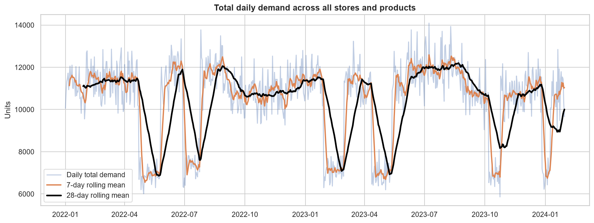
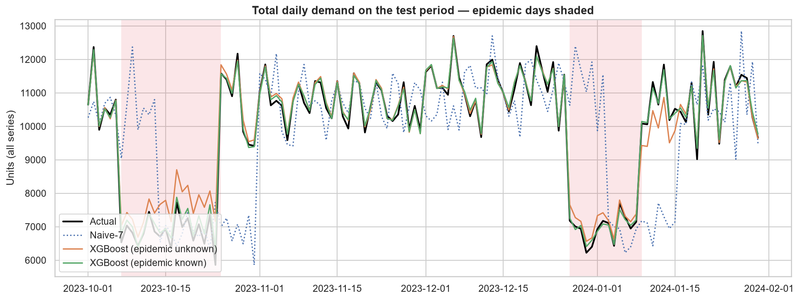
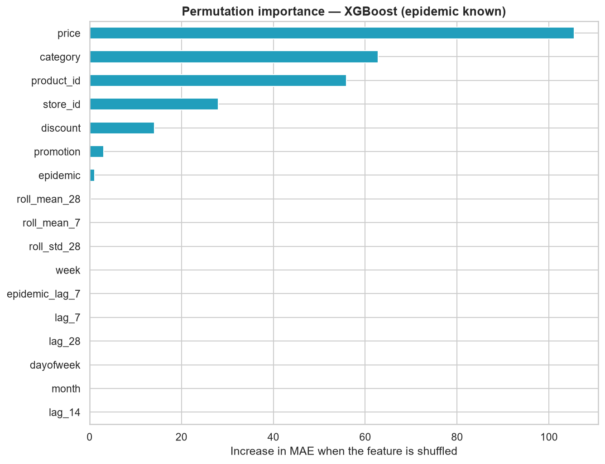
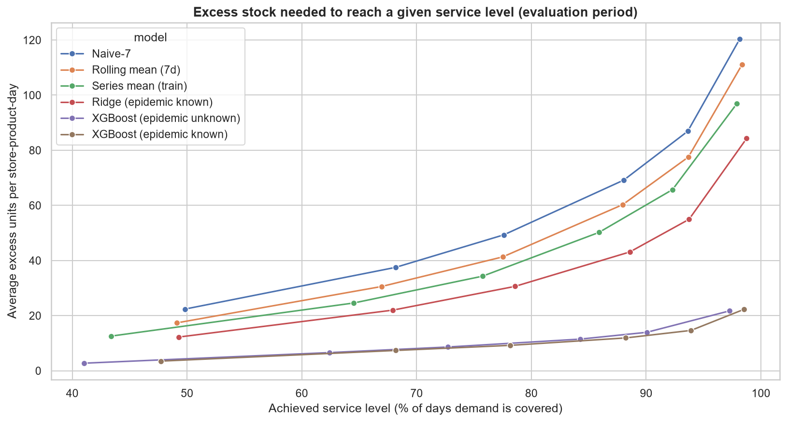

# Retail Demand Forecasting — 7-Day-Ahead Forecasts for 100 Store-Product Series


> **Status:** ✅ complete — EDA, modeling, inventory analysis, experiment tracking, API, Docker and CI.

End-to-end demand forecasting project for a 5-store retailer: leakage-safe time-based validation, honest baselines, error analysis by regime, and a step from forecasts to **inventory decisions** — packaged as a tested, tracked and containerized service.

## TL;DR
- **Task:** forecast `demand` **7 days ahead** for 100 store-product series (5 stores × 20 products, 76,000 daily records, 2022-01-01 → 2024-01-30).
- **Validation:** strictly time-based — train < 2023-07-01, validation 2023-07-01 → 2023-09-30, **test 2023-10-01 → 2024-01-30**. The test period contains epidemic episodes (25.4% of test days vs. 0% in validation), which makes it a regime-shift stress test.
- **Forecast accuracy:** XGBoost reaches **8.2% WAPE** when the epidemic flag is known in advance and **9.1%** when it is not, versus **43.6%** for a naive "same day last week" forecast and **34.0%** for the best baseline (per-series mean).
- **Inventory impact:** at a matched service level (~94%), forecast-based stock targets need about **83% less excess stock** than targets built on the naive forecast.
- **Engineering:** reusable `src/` package, unit tests for data leakage and train/serve skew, MLflow tracking and model registry, FastAPI service, Docker image, GitHub Actions CI.
- **Important caveat:** the model relies almost entirely on planned inputs (price, discount, category, store) and barely uses demand history — see [Limitations](#limitations-and-honest-interpretation).

## Business problem
Stockouts lose sales and overstock ties up capital. Reliable demand forecasts let the retailer decide how much to stock and when to reorder.

## Dataset
- **Name:** `demand_forecasting` — **Source:** _add the download link here_
- 5 stores × 20 products × 760 days. Target: `demand`. Features: price, discount, promotion, competitor price, weather, seasonality label, epidemic flag, inventory.
- Data files are git-ignored. Place the CSV at `data/raw/demand_forecasting.csv`.

## Approach
1. **EDA** (`01_eda.ipynb`): data quality, demand drivers, time-series structure, stockout analysis.
2. **Forecast design** (`02_modeling.ipynb`):
   - **Horizon:** 7 days. Every history feature is at least 7 days old.
   - **Legal features only:** calendar, planned price/discount/promotion, category/store/product, demand lags (7/14/28 days), rolling mean/std of demand shifted by 7 days, and the epidemic status 7 days earlier.
   - **Excluded on purpose:** `units_sold`, `units_ordered` and anything derived from them (outcomes), plus same-day `inventory_level`, `competitor_pricing` and `weather` (not known 7 days ahead).
   - **Leakage unit tests:** assertions verify that lag and rolling features only use data that is ≥ 7 days old.
   - **Two feature sets:** **A** includes the epidemic flag of the target day (a known scenario input); **B** does not.
3. **Models:** Naive-7, rolling mean, per-series mean, Ridge, and XGBoost tuned with a 15-trial random search on the validation period (early stopping on MAE). The final model is refit on train + validation and evaluated **once** on the test set.
4. **Inventory decisions** (`03_inventory_decisions.ipynb`): forecasts become stock targets with an error-based safety buffer.

## Key findings from EDA

**Data**
- 76,000 daily records for **100 store-product series**. The panel is complete: no missing values, duplicates or missing days.
- `product_id` alone is ambiguous (it appears under several categories across stores), so each `(store_id, product_id)` pair is treated as one series.
- `units_sold` never exceeds stock, but it exceeds `demand` in 27.6% of rows, so `demand` is used as the target exactly as the dataset defines it.

**What drives demand**
- **Epidemic periods are the largest effect:** mean demand 70.2 vs. 112.9 (**−38%**) on 20% of days, arranged in separate episodes (regime shifts).
- **Category** sets the scale: Groceries 121.0 … Furniture 73.6.
- **Promotion** is associated with **+30%** demand (95.0 → 123.3), consistently across categories (+29% to +31%). Discount acts as a step: ≥ 15% matches the promotion level, with no extra lift beyond it.
- Weather: Sunny 115.2 vs. Snowy 94.0. Store differences are small (100.6–106.9).

**Time-series behaviour**
- No weekly cycle: weekday means differ by under 2%; the ACF decays slowly with no spikes at lags 7/14/21, and the PACF is significant only at lags 1–2.
- The apparent "trend" is mostly the epidemic regime switching on and off.



**Stockouts**
- **11.4%** of store-product-days end in a stockout, and **17.5%** of total demand (≈ 1.39M units) is unmet.
- Stockouts happen on high-demand days (mean demand 140.8 vs. 99.6).
- Worst store-category pairs: S005 × Clothing (33.0%) and S004 × Electronics (29.6%).

## Forecasting results
Test set: 2023-10-01 → 2024-01-30 (12,200 rows).

| Model | MAE | RMSE | WAPE % | Bias % | WAPE reduction vs. Naive-7 |
|---|---:|---:|---:|---:|---:|
| **XGBoost (epidemic known)** | **8.12** | **10.01** | **8.23** | 0.40 | 81.1% |
| XGBoost (epidemic unknown) | 9.01 | 11.22 | 9.13 | 1.19 | 79.0% |
| Ridge (epidemic known) | 26.45 | 34.13 | 26.80 | 1.92 | 38.5% |
| Series mean (train) | 33.56 | 41.84 | 34.00 | 4.57 | 22.0% |
| Rolling mean (7d) | 36.22 | 45.76 | 36.70 | −0.35 | 15.8% |
| Naive-7 | 42.99 | 54.89 | 43.57 | −0.44 | 0.0% |



### Error analysis
- **Regime changes** (23.0% of test rows, where the epidemic status differs from 7 days earlier) break history-based forecasts: Naive-7 has 60.9% WAPE on these rows vs. 39.1% otherwise. XGBoost stays stable: 10.9% vs. 8.7% (epidemic unknown) and 9.1% vs. 8.0% (epidemic known).
- **Epidemic days are harder** than normal days: 11.1% vs. 7.6% WAPE for XGBoost (epidemic known).
- **By category:** Clothing is the easiest (7.3–7.4% WAPE); Furniture and Toys are the hardest (9.2–11.6%).
- **Bias:** all models are close to unbiased (|Bias| ≤ 1.2%), except the per-series mean (+4.6%) and Ridge (+1.9%).

### What the model uses


Permutation importance (increase in MAE when a feature is shuffled) shows that `price` dominates, followed by `category`, `product_id`, `store_id` and `discount`. **All demand-lag and rolling features have almost zero importance.** Importance shows what the model *uses*, not what *causes* demand.

## From forecasts to inventory decisions
Notebook `03_inventory_decisions.ipynb` converts forecasts into **stock targets**: forecast + a safety buffer taken from past forecast errors (a quantile per category). Buffers are calibrated on Oct–Nov 2023 and evaluated on Dec 2023–Jan 2024, so there is no look-ahead.

| Policy (95% target) | Achieved service level | Avg. excess units / store-product-day | Unmet demand |
|---|---:|---:|---:|
| Naive-7 | 93.6% | 86.9 | 1.7% |
| Rolling mean (7d) | 93.7% | 77.5 | 1.6% |
| Series mean | 92.3% | 65.7 | 1.8% |
| Ridge | 93.7% | 54.9 | 1.1% |
| XGBoost (epidemic unknown) | 90.1% | 13.9 | 0.6% |
| XGBoost (epidemic known) | 93.9% | 14.6 | 0.4% |



- At a matched service level (~94%), XGBoost needs about **83% less excess stock** than the naive forecast.
- **Calibration drift:** without the epidemic flag the model reached 90.1% instead of the 95% target (88.2% on normal days, 96.8% on epidemic days); the epidemic-known model stayed close to the target in both regimes (93.8% / 94.5%). Regime-specific buffers would be the next improvement.
- Compared with the stock the retailer actually held (298.5 units on average, demand covered on 86.3% of days), forecast-based targets average 115.0 units and cover 90.1% of days. This is **indicative only**: observed inventory also covers several days between deliveries, which this analysis does not model.

## Limitations and honest interpretation
- The data looks **synthetic** (complete, no missing values, regular structure), so absolute accuracy should not be read as production performance.
- The strong result mainly reflects how well the **planned inputs (price, discount, category, store)** explain demand in this dataset. History-based features add almost nothing, so this is closer to *demand modeling from planned inputs* than to classical time-series forecasting. The reason for the dominance of `price` was not investigated further.
- Single hold-out period; the validation period contains no epidemic episodes.
- `demand` is used exactly as defined in the dataset; `units_sold` exceeds `demand` in 27.6% of rows, so `demand` is not interpreted as exact "true customer demand".
- The inventory analysis compares policies on historical data; it is not an inventory simulation (no lead times, order costs or capacity limits).
- Feature importance and effects are **associations**, not causal estimates.

## Engineering

### Reusable code and tests
Feature engineering, training and evaluation live in `src/` and are shared by training and serving. Unit tests cover:
- **Data leakage:** changing demand after the forecast origin must not change a day's features.
- **Train/serve consistency:** the single-row inference code must reproduce the training features, and the API must return the same forecast as the training pipeline.
- API validation and error codes, and MLflow logging.

```bash
python -m pytest -q
```

### Experiment tracking (MLflow)
Every training run is tracked with **MLflow** (parameters, test metrics, baseline comparison, feature list, git commit) and the models are registered in the MLflow Model Registry. Re-running the training script reproduces the notebook results (WAPE 8.2% with the epidemic flag, 8.8% without).

```bash
python -m src.train                                    # trains both models and logs two runs
mlflow ui --backend-store-uri sqlite:///mlflow.db      # open http://127.0.0.1:5000
```

### API (FastAPI)
A FastAPI service serves 7-day-ahead forecasts using the same feature code as training.

```bash
uvicorn src.api.main:app --reload      # interactive docs: http://127.0.0.1:8000/docs
```

| Endpoint | Purpose |
|---|---|
| `GET /health`, `GET /info` | health check, model and history information |
| `GET /series` | store-product series that can be forecast |
| `POST /predict`, `POST /predict/batch` | single and batch forecasts |

Example request body for `POST /predict`:
```json
{"store_id": "S001", "product_id": "P0001", "target_date": "2024-02-04",
 "price": 72.7, "discount": 10, "promotion": 1}
```
The forecast date must be within 7 days after the last day of history (the models need 35 days of past demand before the forecast origin); otherwise the API returns `422` with an explanation. If the optional `epidemic` field is sent, the epidemic-known model is used.

### Docker
The image contains only the code. The trained models and the history file are **mounted at run time** (they are not part of the repository). The container runs as a non-root user and has a health check.

```bash
python -m src.train              # creates the models in ./models
docker compose up --build        # serves the API on http://127.0.0.1:8000/docs
```

### Continuous integration
GitHub Actions runs the tests on every push (Python 3.12 and 3.13) and checks that the Docker image builds.

## Project structure
```
demand-forecasting/
├── .github/workflows/ci.yml   # tests + Docker build on every push
├── data/                      # raw and processed data (not tracked)
├── notebooks/
│   ├── 01_eda.ipynb           # data quality, drivers, time-series analysis, stockouts
│   ├── 02_modeling.ipynb      # baselines, lag features, time-based validation, XGBoost
│   └── 03_inventory_decisions.ipynb   # forecasts → stock targets and service levels
├── src/                       # features, training, MLflow tracking, serving, API
├── tests/                     # leakage, train/serve consistency, API and tracking tests
├── models/                    # trained XGBoost models (JSON) + feature spec
├── reports/                   # figures, metrics and summaries
├── Dockerfile · docker-compose.yml
├── requirements.txt · requirements-api.txt
└── README.md
```

## How to run
```bash
python -m venv .venv && source .venv/bin/activate    # Windows: .venv\Scripts\activate
pip install -r requirements.txt
jupyter lab
```
1. Place the dataset at `data/raw/demand_forecasting.csv`.
2. Run the notebooks in order: `01_eda.ipynb` (creates `data/processed/demand_clean.csv`), `02_modeling.ipynb`, `03_inventory_decisions.ipynb`.
3. Retrain from the command line (also creates the files the API needs): `python -m src.train`.
4. Run the tests: `python -m pytest -q`.

## Tech stack
Python · pandas · NumPy · scikit-learn · XGBoost · statsmodels · seaborn / matplotlib · MLflow · FastAPI · Pydantic · Docker · GitHub Actions · pytest · Jupyter

## Possible next steps
- Investigate why `price` dominates (ablation study, price–demand relationship within each series).
- Regime-specific safety buffers to remove the calibration drift.
- A rolling-origin backtest over several test periods instead of a single hold-out.
- Cloud deployment of the container.

## Author
**Ahmed Hosny** — [GitHub](https://github.com/ahmed-hosny755)
