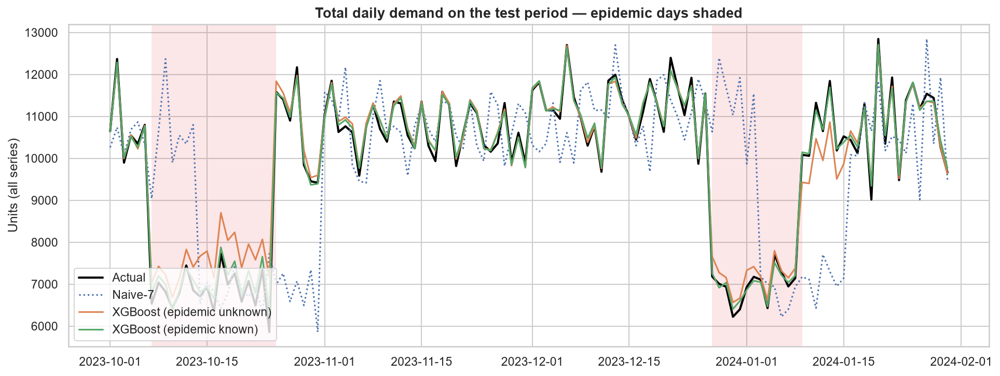
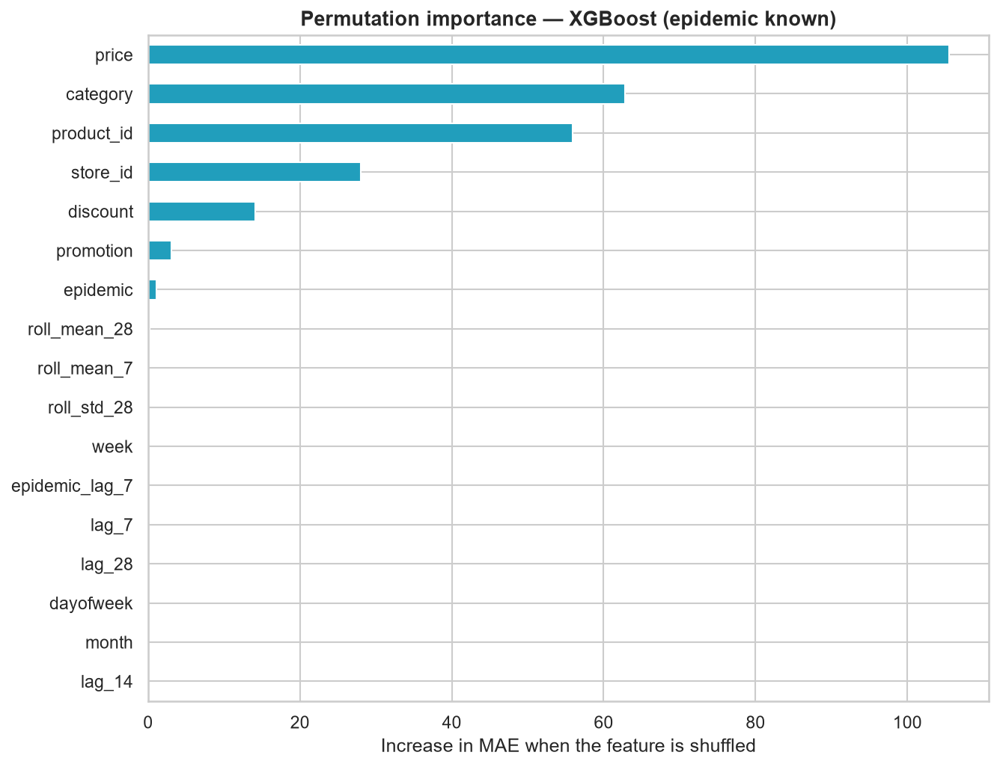
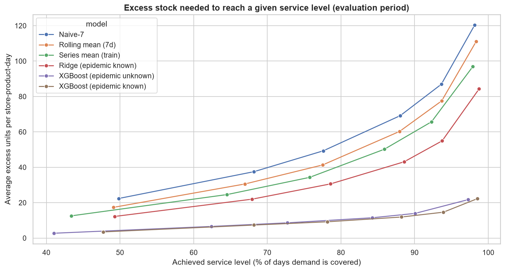

# Retail Demand Forecasting — 7-Day-Ahead Forecasts for 100 Store-Product Series

> **Status:** 🚧 in progress — EDA, modeling and the inventory-decision analysis are complete; sanity checks (ablation study) are next.

Forecasting daily product demand for a 5-store retailer, with a focus on **leakage-safe time-based validation**, honest baselines, error analysis by regime, category and store, and turning forecasts into **stock targets**.

## TL;DR
- **Task:** forecast `demand` **7 days ahead** for 100 store-product series (5 stores × 20 products, 76,000 daily records, 2022-01-01 → 2024-01-30).
- **Validation:** strictly time-based — train < 2023-07-01, validation 2023-07-01 → 2023-09-30, **test 2023-10-01 → 2024-01-30**. The test period contains epidemic episodes (25.4% of test days vs. 0% in validation), which makes it a regime-shift stress test.
- **Result:** XGBoost reaches **8.2% WAPE** when the epidemic flag is known in advance and **9.1%** when it is not, versus **43.6%** for a naive "same day last week" forecast and **34.0%** for the best baseline (per-series mean) — about **76% lower error** than the best baseline.
- **Inventory impact (indicative):** a forecast-based stock target (XGBoost, epidemic unknown, 95% target) cuts average excess stock by **~84% vs. a Naive-7-based target** at a similar-or-lower unmet-demand rate, and holds **~61% less stock** than the inventory actually observed in the data (115 vs. 298 units), while covering demand on more days (90.1% vs. 86.3%). The 95% service-level target was **not** fully reached — see [Inventory decisions](#from-forecasts-to-inventory-decisions).
- **Important caveat:** the model relies almost entirely on planned inputs (price, discount, category, store) and barely uses demand history. See [Limitations](#limitations-and-honest-interpretation).

## Business problem
Stockouts lose sales and overstock ties up capital. Reliable demand forecasts let the retailer decide how much to stock and when to reorder.

## Dataset
- **Name:** `demand_forecasting` — **Source:** `TODO: add the link where you downloaded it`
- 5 stores × 20 products × 760 days. Target: `demand`. Features: price, discount, promotion, competitor price, weather, seasonality label, epidemic flag, inventory.
- Data files are git-ignored. Place the CSV at `data/raw/demand_forecasting.csv`.

## Approach
1. **EDA** (`01_eda.ipynb`): data quality, demand drivers, time-series structure, stockout analysis.
2. **Forecast design** (`02_modeling.ipynb`):
   - **Horizon:** 7 days. Every history feature is at least 7 days old.
   - **Legal features only:** calendar, planned price/discount/promotion, category/store/product, demand lags (7/14/28 days), rolling mean/std of demand shifted by 7 days, and the epidemic status 7 days earlier.
   - **Excluded on purpose:** `units_sold`, `units_ordered` and anything derived from them (outcomes), plus same-day `inventory_level`, `competitor_pricing` and `weather` (not known 7 days ahead).
   - **Leakage unit test:** assertions verify that the lag and rolling features only use data that is ≥ 7 days old.
   - **Two feature sets:** **A** includes the epidemic flag of the target day (a known scenario input); **B** does not.
3. **Models:** Naive-7, rolling mean, per-series mean, Ridge, and XGBoost tuned with a 15-trial random search on the validation period (early stopping on MAE). The final model is refit on train + validation and evaluated **once** on the test set.
4. **Inventory decisions** (`03_inventory_decisions.ipynb`): the test-set forecasts are converted into stock targets with a per-category error buffer (see below).

## Results (test set: 2023-10-01 → 2024-01-30, 12,200 rows)

| Model | MAE | RMSE | WAPE % | Bias % | WAPE reduction vs. Naive-7 |
|---|---:|---:|---:|---:|---:|
| **XGBoost (epidemic known)** | **8.12** | **10.01** | **8.23** | 0.40 | 81.1% |
| XGBoost (epidemic unknown) | 9.01 | 11.22 | 9.13 | 1.19 | 79.0% |
| Ridge (epidemic known) | 26.45 | 34.13 | 26.80 | 1.92 | 38.5% |
| Series mean (train) | 33.56 | 41.84 | 34.00 | 4.57 | 22.0% |
| Rolling mean (7d) | 36.22 | 45.76 | 36.70 | −0.35 | 15.8% |
| Naive-7 | 42.99 | 54.89 | 43.57 | −0.44 | 0.0% |



### Error analysis
- **Regime changes** (23.0% of test rows, where the epidemic status differs from 7 days earlier) break history-based forecasts: Naive-7 has 60.9% WAPE on these rows vs. 39.1% otherwise. XGBoost stays stable: 10.9% vs. 8.7% (epidemic unknown) and 9.1% vs. 8.0% (epidemic known).
- **Epidemic days are harder** than normal days: 11.1% vs. 7.6% WAPE for XGBoost (epidemic known).
- **By category:** Clothing is the easiest (7.3–7.4% WAPE); Furniture and Toys are the hardest (9.2–11.6%).
- **Bias:** all models are close to unbiased (|Bias| ≤ 1.2%), except the per-series mean (+4.6%) and Ridge (+1.9%).

### What the model uses


Permutation importance (increase in MAE when a feature is shuffled) shows that `price` dominates, followed by `category`, `product_id`, `store_id` and `discount`. **All demand-lag and rolling features have almost zero importance.** Importance shows what the model *uses*, not what *causes* demand.

## From forecasts to inventory decisions
A forecast only matters if it improves a decision. `03_inventory_decisions.ipynb` converts the test-set forecasts into a **stock target per store-product-day**:

> `target stock = forecast + buffer`, where the buffer is the **95th percentile of the forecast error** (`demand − forecast`) of each category.

- **Calibration / evaluation split:** buffers are estimated on 2023-10-01 → 2023-11-30 (6,100 rows, 30% epidemic days) and evaluated on 2023-12-01 → 2024-01-30 (6,100 rows, 21% epidemic days), so the evaluation never sees the data used to set the buffers.
- **Metrics:** *service level* = % of days the target covers demand; *excess* = units held above demand; *unmet* = units of demand not covered.

### Policy comparison (evaluation period, 95% target level)

| Model used for the target | Service level % | Avg stock | Avg excess | Excess % of demand | Unmet % of demand | Excess reduction vs. Naive-7 |
|---|---:|---:|---:|---:|---:|---:|
| **XGBoost (epidemic unknown)** | 90.05 | 115.03 | **13.94** | 13.70 | **0.63** | **84.0%** |
| XGBoost (epidemic known) | 93.90 | 116.00 | 14.63 | 14.38 | 0.35 | 83.2% |
| Ridge (epidemic known) | 93.74 | 155.52 | 54.94 | 54.01 | 1.14 | 36.8% |
| Series mean (train) | 92.30 | 165.65 | 65.72 | 64.60 | 1.77 | 24.4% |
| Rolling mean (7d) | 93.67 | 177.66 | 77.51 | 76.20 | 1.55 | 10.8% |
| Naive-7 | 93.62 | 186.90 | 86.89 | 85.42 | 1.69 | 0.0% |



The better the forecast, the smaller the buffer needed for the same service level: XGBoost needs roughly **1/6 of the excess stock** that Naive-7 needs.

### Where the saving comes from
- **By epidemic status:** Naive-7 over-stocks heavily during epidemic days (109 excess units vs. 81 on normal days) because its buffer must absorb regime changes; XGBoost keeps excess at 13–16 units in both regimes.
- **By category:** XGBoost's excess is 10–16 units in every category, versus 69–94 for Naive-7.

### Indicative comparison with the observed inventory

| Policy | Service level % | Avg stock | Avg excess | Excess % of demand | Unmet % of demand |
|---|---:|---:|---:|---:|---:|
| Observed inventory | 86.34 | 298.49 | 203.08 | 199.63 | 6.22 |
| Forecast-based target (XGBoost, epidemic unknown, 95%) | 90.05 | 115.03 | 13.94 | 13.70 | 0.63 |

The forecast-based target covers demand on more days (90.1% vs. 86.3%) while holding ~61% less stock and cutting excess from 203 to 14 units per store-product-day.

### Caveats for the inventory results
- **The 95% target was not reached** by XGBoost (epidemic unknown): 90.05% achieved. The buffers are calibrated on only 2 months with a different epidemic mix (30% vs. 21% of days), and the shortfall is largest for **Toys (85.2%)** and **Furniture (87.3%)**, where the error distribution differs from the calibration period. The epidemic-known model gets closer (93.9%). Longer calibration windows or buffers per category × regime would be the next improvement.
- **The comparison with observed inventory is indicative only.** `inventory_level` is the stock recorded on the same day, not necessarily a replenishment target, and is compared here directly with `demand`. The simulation has no lead times, ordering costs, holding costs or stockout costs, and does not model how the retailer would actually reorder.
- **The data looks synthetic**, so the size of the saving should not be read as an expected real-world result.

## Sanity checks
> TODO: fill in after running section 14 of `02_modeling.ipynb` (ablation study) — one table with the WAPE of "all features", "without price", "without price/discount/promotion", "without lag features" and "only history", plus one sentence on what it shows. Delete this section if you skip it.

## Limitations and honest interpretation
- The data looks **synthetic** (complete, no missing values, regular structure), so absolute accuracy should not be read as production performance.
- The strong result mainly reflects how well the **planned inputs (price, discount, category, store)** explain demand in this dataset. History-based features add almost nothing, so this is closer to *demand modeling from planned inputs* than to classical time-series forecasting.
- Single hold-out period; the validation period contains no epidemic episodes.
- `demand` is used exactly as defined in the dataset; `units_sold` exceeds `demand` in 27.6% of rows, so `demand` is not interpreted as exact "true customer demand".
- Feature importance and effects are **associations**, not causal estimates.
- The inventory analysis is a simplified, single-period simulation (no lead times or costs) and its service-level target was not fully met — see [Caveats for the inventory results](#caveats-for-the-inventory-results).

## Project structure
```
demand-forecasting/
├── data/
│   ├── raw/                  # original CSV (not tracked)
│   └── processed/            # cleaned data and predictions (not tracked)
├── notebooks/
│   ├── 01_eda.ipynb          # data quality, drivers, time-series analysis, stockouts
│   ├── 02_modeling.ipynb     # baselines, lag features, time-based validation, XGBoost
│   └── 03_inventory_decisions.ipynb   # forecasts → stock targets and service levels
├── src/                      # reusable code: features, training, evaluation
├── tests/                    # unit tests (data leakage, train/serve consistency)
├── models/                   # trained XGBoost models (JSON) + feature spec
├── reports/                  # figures, metrics and summaries
├── requirements.txt
└── README.md
```

## How to run
```bash
python -m venv .venv && source .venv/bin/activate    # Windows: .venv\Scripts\activate
pip install -r requirements.txt
jupyter lab
```
Run the notebooks in order: `notebooks/01_eda.ipynb` (creates `data/processed/demand_clean.csv`), then `notebooks/02_modeling.ipynb` (creates `data/processed/test_predictions.csv`), then `notebooks/03_inventory_decisions.ipynb` (writes `reports/inventory_policy_summary.csv` and `reports/inventory_vs_observed.csv`).

## Tech stack
Python 3.13 · pandas · NumPy · scikit-learn · XGBoost · statsmodels · seaborn / matplotlib · Jupyter

## Roadmap
- [x] 01 — EDA and data quality
- [x] 02 — Baselines, lag features, time-based validation, XGBoost, error analysis
- [ ] Sanity checks / ablation study (is the signal in price or in history?)
- [x] 03 — Turn forecasts into inventory decisions (stock targets and service level)
- [ ] Improve service-level calibration (longer calibration window, buffers per category × regime)
- [ ] Experiment tracking (MLflow) and a small API / dashboard

## Author
**Ahmed Hosny** — [GitHub](https://github.com/ahmed-hosny755)